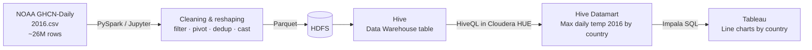

# Big Data BI Pipeline on NOAA Climate Data (PySpark · Hive · Impala · Tableau)

> **Final project of the Big Data Expert Program at U-TAD (Madrid, September 2017).**
> An end-to-end data pipeline that ingests **26+ million raw weather records**, cleans and reshapes them with **PySpark**,
> stores them as a **Hive data warehouse** on HDFS, builds an **analytical datamart**, and serves it to **Tableau** through **Impala**.

**Author:** Pedro Tobarra, Senior Machine Learning / MLOps Engineer (Madrid, Spain)
[LinkedIn](https://es.linkedin.com/in/ptobarra) · [GitHub](https://github.com/ptobarra) · [Tableau Public](https://public.tableau.com/profile/pedro.tobarra.guillamon#!/) · [YouTube](https://www.youtube.com/@pedrotobarra) · [Linktree](https://linktr.ee/ptobarra)

---

## Why this project matters for ML and MLOps

Most of the work in production ML happens before training: getting data that is large, messy and badly shaped into a
reliable, typed, queryable form. This project is that foundation, built on a real-world dataset:

| ML / MLOps skill | Where it shows up in this project |
|---|---|
| **Distributed data processing** | PySpark (RDD + DataFrame APIs) on 26,185,832 NOAA GHCN-Daily records |
| **Data cleaning and feature preparation** | Filtering 5 core variables, long-to-wide reshaping, sentinel handling, deduplication, type casting |
| **Data validation** | Row-count checks after every transformation to make sure no records were lost or duplicated |
| **Efficient storage formats** | Columnar **Parquet** checkpoints at each pipeline stage (instead of CSV/text) |
| **Data warehouse / datamart design** | Hive warehouse table on HDFS → aggregated datamart (daily maximum temperature by country) |
| **Serving data to consumers** | Low-latency SQL with Cloudera Impala, consumed by Tableau dashboards |
| **Reproducibility** | Each pipeline stage is saved as a Parquet snapshot, so later stages can be re-run without redoing earlier ones |

---

## Architecture

**Tech stack:** Apache Spark 2.2.0 · PySpark · Python 2.7 · Jupyter Notebook · Hadoop HDFS · Apache Hive ·
Cloudera Impala · Cloudera HUE · Tableau · Parquet · Java MapReduce (warm-up exercises)

---

## The pipeline, step by step

The main notebook is [`con01/con01 20170812.ipynb`](con01/con01%2020170812.ipynb).

1. **Ingestion.** The NOAA *Global Historical Climatology Network – Daily* file for 2016 is loaded into Spark
   (`spark.read.csv`), and the columns are named after the GHCN spec (`ID, DATE, ELEMENT, DATA_VALUE, M/Q/S-FLAG, OBS-TIME`).
2. **Filtering to the core variables.** Only the 5 core elements are kept: precipitation (`PRCP`), snowfall (`SNOW`),
   snow depth (`SNWD`), maximum temperature (`TMAX`) and minimum temperature (`TMIN`), which gives **26,185,832 rows**.
3. **Feature derivation.** The 2-letter **country code** is extracted from each weather-station ID.
4. **Long-to-wide reshaping.** The data is split by element, each value is renamed into its own column, and the splits are
   unioned back together, with a `-9999` sentinel for missing values. Row counts are checked after each union
   (17,438,604 → 21,813,640 → 26,185,832).
5. **Deduplication and typing.** `dropDuplicates()` brings the data down to **2,527,723 clean rows**. The measurements are cast to
   `float` and dates to `integer`.
6. **Persistence.** Every intermediate stage is written as **Parquet** (`year2016csvUpdatedDF`, `…NoDuplicatesDF`,
   `…TypesChangedDF`, `…FinalDF`), and the final table is also exported as CSV for loading into Hive.
7. **Warehouse to datamart.** In Cloudera HUE, the final DataFrame becomes a Hive warehouse table, and a datamart
   with the **daily maximum temperatures of every country in 2016** is derived from it.
8. **Visualization.** Tableau connects to Impala, queries the datamart, and draws line charts of daily maximum temperature
   filtered by country.

### Result

The Tableau workbooks are in [`con01/tableau_resultados/`](con01/tableau_resultados/).

---

## Repository layout

| Path | Contents |
|---|---|
| [`con01/`](con01/) | Main PySpark notebook, Parquet stages, datamart extracts, Tableau workbooks and results |
| [`datos meteorologicos comienzo proyecto/`](datos%20meteorologicos%20comienzo%20proyecto/) | NOAA GHCN-Daily sample data, station/country lookups and format docs |
| [`sparkTFM 20170715/`](sparkTFM%2020170715/) | Initial project schema and design |
| [`mapReduce 20170712/`](mapReduce%2020170712/), [`mapReducePruebaMailJconca 20170715/`](mapReducePruebaMailJconca%2020170715/) | Java MapReduce log-analysis exercises (Driver / Mapper / Reducer) |
| [`apuntes Spark 20170720.txt`](apuntes%20Spark%2020170720.txt), [`comandos_python_spark_20170721.txt`](comandos_python_spark_20170721.txt) | Working notes on Spark and PySpark (in Spanish) |
| `20170910 PedroTobarra_UTAD_TrabajoFinProgramaExperto.pdf / .docx` | Full project report (in Spanish) |

---

## How I would build this today (modern MLOps stack)

This project dates from 2017. If I built it today as the data layer for an ML system, I would make these changes:

| 2017 approach | Today |
|---|---|
| Notebook run by hand | Modular PySpark jobs orchestrated with **Airflow**, **Databricks Workflows** or **Azure Data Factory** |
| Parquet files on HDFS | **Delta Lake** / Iceberg tables on cloud object storage (ADLS / S3) with ACID transactions and time travel |
| Hive + Impala | **Databricks SQL** / Unity Catalog with lineage and access control |
| Row-count checks in cells | Automated data-quality checks (**Great Expectations**, Delta expectations) in **CI/CD** |
| Manual `-9999` pivot via unions | One `groupBy().pivot()`, with proper null handling |
| BI dashboard as the end product | A **feature table** feeding a temperature-forecasting model, with experiments tracked in **MLflow**, served through **FastAPI** in **Docker**, and monitored for data drift |
| Python 2.7, Spark 2.2 | Python 3.11+, Spark 3.5, tests with `pytest` |

---

## About me

I'm a **Senior Machine Learning Engineer** based in Madrid. I work with **Python, Azure, Databricks, PyTorch, Keras,
LLMs/RAG, FastAPI and Docker**, and I build ML systems from raw data through training to production
deployment and monitoring.

**I'm open to Senior ML/AI Engineer and Senior MLOps Engineer roles.** Let's connect on
[LinkedIn](https://es.linkedin.com/in/ptobarra).

---

## Data source

NOAA National Centers for Environmental Information, *Global Historical Climatology Network – Daily (GHCN-Daily)*:
<https://www.ncei.noaa.gov/products/land-based-station/global-historical-climatology-network-daily>
